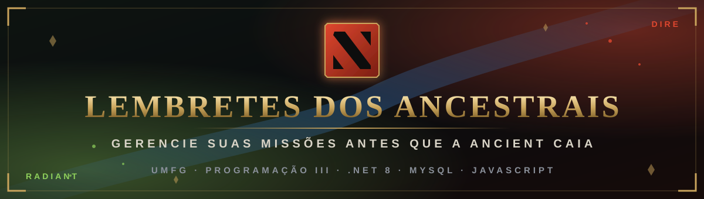

<p align="center">
  
</p>

<p align="center">
  
  
  
  
  
</p>

<p align="center">
  <b>⚔️ Trabalho bimestral de Programação III · UMFG ⚔️</b><br>
  <i>Gerencie suas missões antes que a Ancient caia.</i>
</p>

<p align="center"></p>

## 📜 A Lenda

Nas terras entre o **Radiant** 🌳 e o **Dire** 🔥, os Ancestrais guardam uma lista de missões que nenhum herói pode esquecer: comprar a *Black King Bar* a tempo, colocar a *ward* no Roshan, guardar ouro para o *buyback*...

**Lembretes dos Ancestrais** é a aplicação que guarda essa lista. Ela tem duas partes:

- uma **API REST em .NET 8 (Minimal API)** com banco **MySQL**;
- um **front-end em HTML, CSS e JavaScript puro**, com a interface e o relatório em PDF no visual do **Dota 2**.

O ponto de partida foram os repositórios do professor:

> 🗡️ [`leicam/umfg-programacao-iii-minimal-api-2026`](https://github.com/leicam/umfg-programacao-iii-minimal-api-2026)<br>
> 🛡️ [`leicam/umfg-programacao-iii-front-end-2026`](https://github.com/leicam/umfg-programacao-iii-front-end-2026)

<p align="center"></p>

## 🗺️ Mapa da Partida

| | Seção |
|:-:|---|
| 🎒 | [Inventário do Herói (tecnologias)](#inventario) |
| 👥 | [Composição do Time (estrutura)](#time) |
| ⏳ | [Fase de Preparação (como executar)](#preparacao) |
| 🔮 | [Grimório do Invoker (endpoints)](#grimorio) |
| 🐦 | [O Courier (comunicação front ↔ API)](#courier) |
| 🛡️ | [Glyph of Fortification (CORS)](#cors) |
| ✨ | [Habilidades (funcionalidades)](#habilidades) |
| 📖 | [Tomo do Conhecimento (relatório PDF)](#pdf) |
| 🔨 | [Patch Notes (o que foi alterado)](#patch) |
| 🏆 | [Placar Final (testes)](#placar) |
| 🤝 | [GG WP (créditos)](#creditos) |

<p align="center"></p>

<a name="inventario"></a>
## 🎒 Inventário do Herói

Todo herói precisa de uma boa build. Esta é a do projeto:

| Slot | Item | Tecnologia | Por quê |
|:-:|---|---|---|
| 1 | 🟡 **Black King Bar** | .NET 8 · ASP.NET Core Minimal API | Aguenta firme no meio da teamfight |
| 2 | 🔷 **Aghanim's Scepter** | Entity Framework Core 8 · MySql.EntityFrameworkCore | Dá superpoderes ao acesso a dados |
| 3 | 🏛️ **Refresher Orb** | MySQL 8 | Guarda tudo e traz de volta quando precisa |
| 4 | 📜 **Tome of Knowledge** | QuestPDF 2026.9.1 | Transforma a lista em relatório |
| 5 | ⚡ **Blink Dagger** | HTML5 · CSS3 · JavaScript (Fetch API) | Rápido, leve e sem framework |
| 6 | 🎨 **Divine Rapier** | Cinzel · Barlow · Barlow Condensed (OFL) | O visual que faz a diferença |

<p align="center"></p>

<a name="time"></a>
## 👥 Composição do Time

```
TRABALHO-BIMESTRAL-PROG-III-30-10-2026/
│
├── 🔥 api/                                  ← lado Dire: o servidor
│   ├── umfg.programacaoiii.minimalapi.2026.sln
│   └── umfg.programacaoiii.minimalapi.2026/
│       ├── Contexto/          # MySqlContexto (EF Core)
│       ├── DTO/               # LembreteDTO e LembreteQueryDTO (filtro/paginação)
│       ├── Entidades/         # Lembrete
│       ├── Migrations/        # migrações do banco
│       ├── Fontes/            # fontes .ttf do PDF + licenças OFL
│       ├── Program.cs         # endpoints, CORS, filtro e geração do PDF
│       └── appsettings*.json  # connection string por ambiente
│
├── 🌳 front-end/                            ← lado Radiant: a interface
│   ├── index.html             # página única da aplicação
│   ├── css/style.css          # tema Dota 2, responsivo
│   └── js/app.js              # chamadas à API, renderização e validações
│
├── 🖼️ docs/                                 ← banner e divisores deste README
└── 📜 README.md
```

| Posição | Herói | Papel no projeto |
|:-:|---|---|
| 1 · Carry | ⚔️ **Juggernaut** | `Program.cs`: segura os endpoints e as regras de negócio |
| 2 · Mid | 🔮 **Invoker** | `app.js`: combina filtros, ordenação e paginação |
| 3 · Offlane | 🪓 **Axe** | Validações: barra qualquer dado inválido com `400` |
| 4 · Suporte | 📖 **Rubick** | QuestPDF: copia a lista e transforma em relatório |
| 5 · Hard Support | ❄️ **Crystal Maiden** | `style.css`: cuida do visual e do responsivo |

<p align="center"></p>

<a name="preparacao"></a>
## ⏳ Fase de Preparação

### 🧾 Pré-requisitos (a compra inicial)

- 🪙 [.NET 8 SDK](https://dotnet.microsoft.com/download/dotnet/8.0)
- 🪙 MySQL 8 rodando em `localhost:3306`
- 🪙 Um servidor estático para o front-end (ex.: extensão **Live Server** do VS Code)

### 🕐 Minuto 0:00 · Banco de dados

Informe a senha do seu MySQL na connection string de `api/umfg.programacaoiii.minimalapi.2026/appsettings.Development.json`:

```json
"ConnectionString": "Server=localhost;Port=3306;Database=umfg_lembrete_develop;Uid=root;Pwd=SUA_SENHA;"
```

> [!TIP]
> Para não gravar a senha em arquivo, defina a variável de ambiente `ConnectionString`. Ela tem prioridade sobre o `appsettings`.

Crie o banco aplicando as migrações (dentro de `api/umfg.programacaoiii.minimalapi.2026`):

```bash
dotnet ef database update
```

### 🕑 Minuto 0:30 · Certificado HTTPS

O front-end chama a API em `https://localhost:7063`. Confie no certificado de desenvolvimento do .NET:

```bash
dotnet dev-certs https --trust
```

> [!WARNING]
> Se o navegador continuar recusando o certificado (`ERR_CERT_AUTHORITY_INVALID`), limpe e confie de novo:

```bash
dotnet dev-certs https --clean
```

```bash
dotnet dev-certs https --trust
```

### 🕒 Minuto 1:00 · Subir a API

Dentro de `api/umfg.programacaoiii.minimalapi.2026`, ou abrindo o `.sln` no Visual Studio com o perfil **https**:

```bash
dotnet run --launch-profile https
```

🔥 A API sobe em `https://localhost:7063` (e `http://localhost:5207`).

### 🕓 Minuto 1:30 · Abrir o front-end

Abra a pasta `front-end` com um servidor estático (ex.: Live Server) e acesse o `index.html`.

> [!NOTE]
> Abrir o arquivo direto pelo `file://` não é recomendado.

🌳 **A batalha começou. Boa partida!**

<p align="center"></p>

<a name="grimorio"></a>
## 🔮 Grimório do Invoker

*Quas, Wex, Exort...* Cada endpoint é um feitiço:

| Feitiço | Método | Rota | O que faz | Respostas |
|---|:-:|---|---|:-:|
| ☀️ Sun Strike | `GET` | `/lembretes` | Lista todos os lembretes ativos | 200 |
| 👁️ Ghost Walk | `GET` | `/lembretes/{id}` | Busca um lembrete ativo pelo id | 200 · 400 · 404 |
| 🌪️ Tornado | `GET` | `/lembretes/filtro` | Filtra, ordena e pagina | 200 · 400 |
| 📜 Deafening Blast | `GET` | `/lembretes/imprimir` | Gera o PDF com os mesmos filtros | 200 · 400 |
| 🔥 Forge Spirit | `POST` | `/lembretes` | Cria um lembrete | 201 · 400 |
| ❄️ Cold Snap | `PUT` | `/lembretes/{id}` | Atualiza a descrição | 200 · 400 · 404 |
| ☄️ Chaos Meteor | `DELETE` | `/lembretes/{id}` | Exclusão lógica (`IsAtivo = false`) | 204 · 400 · 404 |

### 🧪 Ingredientes do Tornado e do Deafening Blast

| Parâmetro | Tipo | Exemplo |
|---|---|---|
| `NumeroPagina` | int (≥ 1) | `1` |
| `TamanhoPagina` | int (1 a 100) | `10` |
| `Ordem` | `Descricao` · `DataCadastro` · `DataAtualizacao` · `IsAtivo` | `DataCadastro` |
| `Direcao` | `ASC` · `DESC` | `DESC` |
| `Descricao` | texto (busca parcial) | `blink` |
| `DataCadastroInicial` / `DataCadastroFinal` | data | `2026-10-01` |
| `DataAtualizacaoInicial` / `DataAtualizacaoFinal` | data | `2026-10-31` |

Como o endpoint usa `[AsParameters]`, **todos os parâmetros são obrigatórios** na query string. Quando um filtro de data não é preenchido, o front-end envia `1900-01-01` (inicial) e `2999-12-31` (final), que funcionam como "sem limite".

<details>
<summary>🌪️ <b>Ver exemplo de requisição e resposta</b></summary>

```http
GET /lembretes/filtro?NumeroPagina=1&TamanhoPagina=10&Ordem=DataCadastro&Direcao=DESC&Descricao=&DataCadastroInicial=1900-01-01&DataCadastroFinal=2999-12-31&DataAtualizacaoInicial=1900-01-01&DataAtualizacaoFinal=2999-12-31
```

```json
{
  "lembretes": [
    {
      "id": "…",
      "descricao": "Comprar Black King Bar antes dos 25 minutos",
      "dataCadastro": "…",
      "dataAtualizacao": "…",
      "isAtivo": true
    }
  ],
  "total": 12,
  "numeroPagina": 1,
  "tamanhoPagina": 10
}
```

</details>

<p align="center"></p>

<a name="courier"></a>
## 🐦 O Courier

Todas as entregas entre o front-end e a API passam pela função `requisitar()` em `js/app.js`. Ela usa `fetch` e transforma cada falha numa mensagem clara:

| Situação | Mensagem na tela |
|---|---|
| 💀 Sem resposta (API desligada, certificado ou CORS) | *"Não foi possível conectar à API. Verifique se ela está em execução."* |
| 🪓 `400` | A mensagem de validação da própria API (ex.: *"A descrição deve ter no máximo 500 caracteres."*) |
| 👻 `404` | *"Lembrete não encontrado. Ele pode ter sido excluído."* |
| 🔥 `500` | *"Erro interno na API. Tente novamente em instantes."* |

🔍 Os parâmetros do filtro são montados com `URLSearchParams` e registrados no console (`filtro-> params`), o que facilita conferir as requisições na aba **Network** do DevTools.

<p align="center"></p>

<a name="cors"></a>
## 🛡️ Glyph of Fortification

A API protege a base com a política **CORS** `Frontend`:

```csharp
builder.Services.AddCors(options =>
{
    options.AddPolicy("Frontend", policy =>
        policy.AllowAnyOrigin().AllowAnyHeader().AllowAnyMethod());
});

app.UseCors("Frontend");
```

O front-end roda em outra origem (ex.: `http://127.0.0.1:5500`). Por isso o navegador manda um batedor na frente: uma requisição **preflight `OPTIONS`** antes de cada `POST`, `PUT` e `DELETE` com JSON. A API responde `204` com `Access-Control-Allow-Origin: *`, e a chamada real é liberada.

> [!IMPORTANT]
> Em produção, o ideal é restringir a origem com `.WithOrigins("https://dominio-do-front")`.

<p align="center"></p>

<a name="habilidades"></a>
## ✨ Habilidades

| Tecla | Habilidade | Efeito |
|:-:|---|---|
| **Q** | ⚔️ **CRUD completo** | Criar, editar, buscar por id e excluir lembretes |
| **W** | 🔍 **Filtros** | Descrição, data de cadastro (de/até) e data de atualização (de/até) |
| **E** | 📄 **Paginação** | Primeira, anterior, números com reticências, próxima e última. Tamanho de 5, 10, 20 ou 50 |
| **R** | 🔃 **Ordenação** *(ultimate)* | Clicando no cabeçalho da coluna. Clicar de novo inverte a direção, e a seta mostra a ordem (`aria-sort`) |
| **D** | 💬 **Mensagens** | Toasts de sucesso, aviso e erro; estados de carregando, lista vazia e erro com **"Tentar novamente"** |
| **F** | 🛑 **Confirmação** | Modal antes de excluir, que fecha por Cancelar, Esc ou clique fora |
| 🗡️ | 🖨️ **Imprimir** | Baixa o PDF com os filtros, a ordenação e a página atuais |
| 🛡️ | 🔒 **Linken's Sphere** | Descrições escapadas: um texto como `` aparece como texto e não é executado |
| 👟 | 📱 **Boots of Travel** | Responsivo até 375 px, sem rolagem horizontal na página |

**Validações no formulário:** campo obrigatório com destaque, contador de 0 a 500 caracteres e aviso quando a data inicial do filtro é maior que a final.

### 🎨 Paleta Radiant × Dire

| Amostra | Elemento | Cor |
|:-:|---|---|
| ⬛ | Fundo (pedra escura) | `#0A0C0F` · `#171B21` |
| 🟥 | Vermelho Dire (ações principais) | `#B8321F` · `#E0472F` |
| 🟨 | Dourado (títulos e destaques) | `#C9A45C` |
| 🟩 | Verde Radiant (status ativo) | `#8FD15B` |

✒️ Tipografia: **Cinzel** nos títulos, **Barlow Condensed** nos rótulos e botões e **Barlow** no texto.

<p align="center"></p>

<a name="pdf"></a>
## 📖 Tomo do Conhecimento

O relatório é gerado pela API com **QuestPDF**, no mesmo tema do front-end:

- 🏰 **Cabeçalho** repetido em todas as folhas: emblema, título *Lembretes dos Ancestrais*, subtítulo **RELATÓRIO DE MISSÕES** e linha em degradê vermelho.
- 📊 **Indicadores:** total encontrado, registros nesta folha, página da listagem e ordenação usada.
- 🔍 **Filtros aplicados** em texto legível (ex.: *"cadastro a partir de 01/10/2026"*).
- 📋 **Tabela** com linhas alternadas e status em selo **ATIVO** 🟩 / **INATIVO** 🟥.
- 🦶 **Rodapé:** *UMFG · PROGRAMAÇÃO III* e a numeração **FOLHA X DE Y**.
- ✒️ As fontes Cinzel e Barlow ficam em `Fontes/` e vão para a saída do build. Emoji e símbolos que elas não têm usam fontes do sistema como reserva.

<p align="center"></p>

<a name="patch"></a>
## 🔨 Patch Notes

### 🔥 API · Patch 1.1

> Arquivos alterados: `Program.cs`, `Entidades/Lembrete.cs`, `.csproj` e `.http`

#### ⚔️ Mudanças gerais

| Alteração | Antes | Depois |
|---|---|---|
| 🔃 Ordenação | `OrderBy(x => dto.Ordem)` ordenava por uma string constante, ou seja, não ordenava | `switch` por campo (`Descricao`, `DataCadastro`, `DataAtualizacao`, `IsAtivo`) e direção `ASC`/`DESC` |
| 🔤 Codificação | `Program.cs` em cp1252 ("Relat�rio") | UTF-8 |
| 📖 Relatório PDF | Layout simples | Layout novo no tema Dota 2, com fontes próprias registradas via `FontManager` |
| ♻️ Lógica do filtro | Duplicada nos endpoints de filtro e de impressão | Extraída para o método `FiltrarLembretes` |
| 🔥 POST | Recebia a entidade `Lembrete` direto no corpo | Recebe `LembreteDTO`, valida e só então cria a entidade |
| 📝 Arquivo `.http` | Exemplo do template (`/weatherforecast`), rota inexistente | Exemplos reais: listar, filtrar e criar lembretes |
| 📦 `.csproj` | — | Copia `Fontes/*.ttf` para a pasta de saída |

#### 🐉 Roshans abatidos (bugs corrigidos)

| | Bug | Antes | Depois |
|:-:|---|---|---|
| 🐉 | **PUT com descrição vazia** | Era gravado no banco e fazia **todas** as consultas seguintes falharem com 500 | Recusado com 400; a entidade também passou a rejeitar descrição vazia |
| 🐉 | Descrição vazia ou longa no POST/PUT | Descrição vazia ou com mais de 500 caracteres → **500** | **400** com mensagem |
| 🐉 | Id inválido (`/lembretes/abc`) | `Guid.Parse` lançava exceção → 500 | `Guid.TryParse` → 400 |
| 🐉 | PUT/DELETE em lembrete já excluído | Editava ou "excluía" de novo | 404 |
| 🐉 | Página ou tamanho enormes | Estouro no cálculo do `Skip` → 500 | Tamanho máximo 100 e proteção contra estouro → 400 |
| 🐉 | PDF com emoji ou símbolos | QuestPDF lançava exceção por caractere ausente → 500 | Fontes de reserva do sistema; o PDF sai normalmente |
| 🐉 | Data final extrema (`9999-12-31`) | `AddDays(1)` estourava o limite do `DateTime` → 500 | Comparação só pela data, sem estouro |

### 🌳 Front-end · Patch 1.1

> Arquivos alterados: `index.html`, `css/style.css` e `js/app.js`

- 🎨 Interface reescrita no tema Dota 2, responsiva.
- 🔍 Todos os filtros, paginação, tamanho de página e ordenação clicando no cabeçalho.
- 🐦 Função `requisitar()` centralizando o `fetch` e o tratamento de erros por status.
- 🪓 Nos erros 400, a tela mostra a mensagem de validação vinda da API.
- ⏳ Estados de carregando, lista vazia e erro com **"Tentar novamente"**.
- ✅ Validação de campo obrigatório, contador de caracteres e intervalo de datas.
- 🛑 Modal de confirmação de exclusão no lugar do `confirm()` nativo.
- 💬 Toasts de sucesso, aviso e erro.
- 🔒 Escape de HTML nas descrições.
- ↩️ Ao excluir o último item da última página, a tela volta para a página anterior.
- ⚡ Cliques rápidos em ordenar ou paginar não mostram resultado desatualizado: só a última consulta é exibida.
- 💀 Com a API fora do ar, a paginação é zerada, sem botões de próxima página ativos para uma lista vazia.

<p align="center"></p>

<a name="placar"></a>
## 🏆 Placar Final

<p align="center">
  <b>🌳 RADIANT VICTORY 🌳</b><br>
  <sub>80 testes · 80 aprovados · 0 derrotas</sub>
</p>

| Time | Cenários | Resultado |
|---|:-:|:-:|
| 🔥 API | 42 | ✅ 42/42 · **Rampage!** |
| 🌳 Front-end | 38 | ✅ 38/38 · **Godlike!** |

<details>
<summary>🔥 <b>API: 42 cenários</b></summary>

- ✅ CRUD feliz: POST 201, GET por id 200, PUT 200, GET todos 200, DELETE 204.
- ✅ POST com descrição vazia, só com espaços, ausente, JSON inválido e 501 caracteres → 400. Com exatamente 500 caracteres → 201.
- ✅ GET, PUT e DELETE com id inválido → 400. Com id inexistente → 404.
- ✅ PUT com descrição vazia ou com 501 caracteres → 400.
- ✅ Filtro: página 0, tamanho 0, tamanho negativo, data inválida, página enorme e tamanho enorme → 400.
- ✅ Direção ou ordem inválidas e direção em minúsculo → 200, com valor padrão.
- ✅ Caracteres especiais do `LIKE` (`%`, `_`, `\`) → 200.
- ✅ PDF: padrão, com filtros, sem resultados e com emoji → 200 `application/pdf`. Página 0 → 400.
- ✅ CORS: preflight `OPTIONS` → 204 com `Access-Control-Allow-Origin: *`.
- ✅ Depois de excluir: GET, PUT e um segundo DELETE → 404.
- ➕ Verificado à parte: datas finais extremas (`9999-12-31`) no filtro e no PDF → 200.

</details>

<details>
<summary>🌳 <b>Front-end: 38 cenários</b></summary>

- ✅ Campo obrigatório, contador, criar, editar e escape de HTML.
- ✅ Mensagem de 400 vinda da API (descrição longa enviada sem passar pelo `maxlength`).
- ✅ Filtro por descrição, lista vazia, limpar filtros, intervalo de datas inválido e filtro só com data inicial.
- ✅ Ordenação crescente e decrescente, e cliques rápidos seguidos.
- ✅ Paginação: tamanho 5, próxima, última, número de página, botões desabilitados e volta automática ao excluir o último item da página.
- ✅ Modal: cancelar, Esc, clique fora e confirmar. Excluir o lembrete aberto em edição fecha o formulário.
- ✅ Editar um lembrete que já foi excluído → mensagem de "não encontrado".
- ✅ Imprimir com sucesso; listar, criar e imprimir com a API desligada, seguido de "Tentar novamente".
- ✅ Layout em 375 px sem rolagem horizontal.

</details>

<p align="center"></p>

<a name="creditos"></a>
## 🤝 GG WP

- 🎓 **Projeto base:** repositórios da disciplina de Programação III, UMFG.
- ✒️ **Fontes:** [Cinzel](https://github.com/NDISCOVER/Cinzel) e [Barlow](https://github.com/jpt/barlow), sob a **SIL Open Font License 1.1**. As licenças estão em `Fontes/OFL-Cinzel.txt` e `Fontes/OFL-Barlow.txt`.
- 📖 **[QuestPDF](https://www.questpdf.com/)**, usado sob a licença Community.
- 🖼️ **Banner e divisores** (`docs/`): arte original feita para este projeto.

> [!NOTE]
> *Dota 2* e os nomes de heróis, itens e habilidades citados são marcas da **Valve Corporation**. Este é um projeto acadêmico, sem fins comerciais e sem vínculo com a Valve. O tema é só uma inspiração visual (cores, tipografia e referências) e não usa nenhuma imagem ou arquivo oficial do jogo.

<p align="center">
  <br>
  <b>⚔️ Que os Ancestrais guiem seus lembretes. GG! ⚔️</b>
</p>
